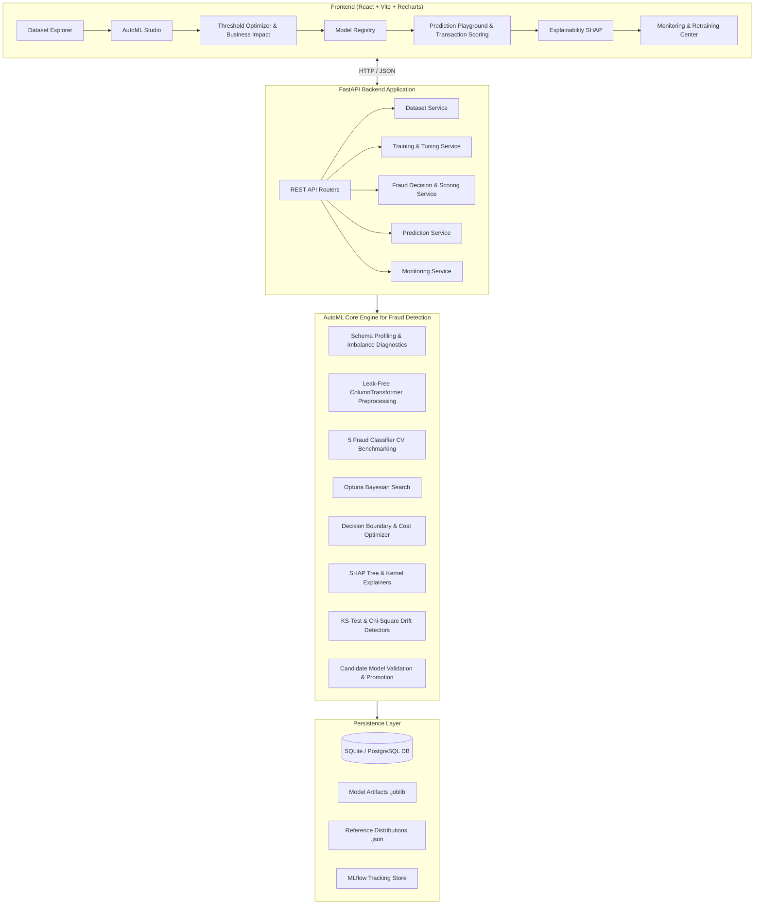

# AutoFlow AI — Integrated AutoML & MLOps Platform for Fraud Detection

[](https://www.python.org/)
[](https://fastapi.tiangolo.com/)
[](https://react.dev/)
[](https://vitejs.dev/)
[](https://mlflow.org/)
[](https://pytest.org/)

An end-to-end, production-minded **AutoML & MLOps platform specifically engineered for financial and transaction fraud detection**. Upload raw transaction CSV datasets and AutoFlow AI autonomously executes the complete machine learning lifecycle with zero mandatory manual configuration — automated schema profiling, class imbalance handling (SMOTE & balanced class weighting), leakage-free preprocessing, 5 fraud classification algorithm cross-validated benchmarking, Optuna Bayesian hyperparameter tuning, MLflow experiment tracking, versioned model persistence, decision threshold optimization, financial business impact analysis, real-time transaction risk scoring with latency tracking, SHAP feature explainability, Kolmogorov-Smirnov & Chi-Square feature drift monitoring, and autonomous retraining workflows with rollback safeguards.

```
Upload Transaction CSV → Imbalance Profiling (SMOTE / Class Weights) → Benchmark 5 Fraud Models 
    → Optuna Tuning → MLflow Tracking → Decision Threshold & Business Cost Optimization 
    → Model Registry → Serve REST API & Risk Scoring → SHAP Explainability 
    → Monitor Drift & Latency → Autonomous Retraining
```

---

## Architecture Diagram



---

## Key Features

1. **Dataset Ingestion & Imbalance Diagnostics**
   - Safe CSV upload with size (50MB) and encoding validation (UTF-8, Latin-1).
   - Inferred column types: `numerical`, `categorical`, `boolean`, `datetime`, `constant`, and `high_cardinality`.
   - Missing-value statistics and descriptive summary metrics.
   - Fraud class imbalance profiling: detects minority ratio, calculates imbalance severity, and suggests mitigation strategies (SMOTE resampling + class weighting).
   - Includes realistic financial fraud dataset: `sample_data/fraud_transactions.csv` (5,000 transactions, ~4.5% fraud rate with amount, velocity, location, and merchant features).

2. **Leakage-Free Preprocessing & Resampling**
   - Reusable `scikit-learn` `ColumnTransformer` pipelines.
   - Numerical features: median imputation + standard z-score scaling.
   - Categorical features: most-frequent imputation + one-hot encoding with unknown category handling.
   - Guaranteed leakage prevention: SMOTE and preprocessors fit strictly on training splits/folds; never fitted on validation or holdout sets.

3. **5-Model Fraud Classification Benchmarking**
   - **Candidate Algorithms:**
     1. **Logistic Regression** (L2-penalized, balanced class weight, baseline estimator)
     2. **Random Forest (Fraud)** (ensemble of trees with leaf regularization and balanced class weights)
     3. **Extra Trees (Fraud)** (extremely randomized trees with balanced class weighting)
     4. **HistGradientBoosting** (histogram-based gradient boosting optimized for mixed-type tabular features)
     5. **Gradient Boosting** (stage-wise additive modeling with sub-sampling)
   - Stratified K-fold cross-validation evaluated with fraud-specific metrics:
     - **PR-AUC (Precision-Recall Area Under Curve / Average Precision)** — primary ranking metric for imbalanced fraud distributions
     - **F2-Score** — recall-weighted F-measure prioritizing fraud detection over false alarms
     - **Detection Rate (Recall / Sensitivity)** & **Specificity (True Negative Rate)**
     - **Precision, Accuracy, ROC-AUC, and Confusion Matrix**
   - Asynchronous execution with polling endpoints and live progress tracking.

4. **Decision Threshold Optimization & Business Impact Calculator**
   - Standard 0.5 decision thresholds fail on imbalanced fraud data; AutoFlow AI computes the optimal decision boundary under multiple strategies:
     - `f2`: Maximizes F2-score (heavily penalizes missed fraud)
     - `f1`: Maximizes harmonic mean of precision and recall
     - `cost`: Minimizes overall operational business cost based on custom false positive investigation costs ($FP) and false negative missed fraud costs ($FN)
     - `precision_at_recall`: Maximizes precision subject to a minimum fraud catch rate constraint
   - Calculates estimated net dollar savings compared to a zero-model baseline.

5. **Optuna Bayesian Hyperparameter Tuning**
   - Configurable trial count (default 10, max 50).
   - Algorithm-specific parameter search spaces (tree depths, min samples leaf, learning rates, regularizations).
   - Live trial score curve and side-by-side comparison against baseline score.

6. **MLflow Experiment Tracking**
   - Tracks experiment name, run ID, dataset ID, algorithms, hyperparameters, cross-validation scores, test metrics, training duration, and model artifacts.
   - Uses local file tracking by default (`./mlruns`).

7. **Model Registry & Safe Persistence**
   - SQLAlchemy backed registry with versioning, timestamps, hyperparameters, and metrics.
   - Safe loading of trusted serialized pipelines (`joblib`).
   - One-click active model promotion for real-time inference and transaction scoring.

8. **Real-Time Fraud Transaction Scoring REST API**
   - Dedicated fraud scoring endpoint (`/api/fraud/score-transaction`) returning:
     - Model confidence score / fraud probability
     - Calibrated Risk Level: `LOW`, `MEDIUM`, `HIGH`, `CRITICAL`
     - Investigation recommendation flag
     - Per-call inference latency tracking
   - Standard single and batch inference endpoints for generalized classification.

9. **Global & Local Explainability with SHAP**
   - TreeExplainer for tree models; LinearExplainer and sampled Explainer fallbacks.
   - Global feature importance rankings identifying key fraud indicators (e.g. transaction velocity, unusual hours, foreign country, amount).
   - Base64 summary visualization plots and feature impact breakdown.

10. **Production Monitoring & Statistical Drift Detection**
    - Baseline reference distributions saved during training.
    - **Numerical Drift:** Two-sample Kolmogorov-Smirnov test (`scipy.stats.ks_2samp`).
    - **Categorical Drift:** Chi-Square goodness-of-fit test (`scipy.stats.chisquare`).
    - Rolling inference latency analytics (Mean, P95, latency spikes).
    - Concept drift verification interface with ground-truth recording.

11. **Autonomous Retraining Workflow**
    - Triggered manually or automatically when drift thresholds are breached.
    - Trains candidate model on updated data, validates against active model on holdout set.
    - Safe promotion: Promoted only if candidate meets performance tolerance; preserves old model for rollback.

---

## Tech Stack

| Layer | Technologies |
|---|---|
| **Backend API** | FastAPI, Uvicorn, Pydantic v2, Python 3.12 |
| **Machine Learning** | scikit-learn, Optuna, SHAP, NumPy, pandas, SciPy, joblib |
| **Experiment Tracking** | MLflow |
| **Database & ORM** | SQLAlchemy 2.0 (SQLite by default, PostgreSQL supported via `DATABASE_URL`) |
| **Frontend** | React 18, Vite, Vanilla CSS Design System, Lucide React, Recharts |
| **Testing** | pytest, pytest-asyncio, HTTPX |
| **DevOps & Containers** | Docker, Docker Compose |

---

## Project Structure

```
autoflow-ai/
├── backend/
│   ├── main.py                  # FastAPI application entrypoint & middleware
│   ├── config.py                # Centralized pydantic settings
│   ├── database.py              # SQLAlchemy engine & session manager
│   ├── models_db.py             # ORM tables: Dataset, MLModel, TrainingJob, etc.
│   ├── schemas.py               # Pydantic request & response models
│   ├── requirements.txt         # Pinned backend dependencies
│   ├── Dockerfile               # Production-ready Python 3.12 container
│   ├── automl/
│   │   ├── preprocessing.py     # Schema profiling, fraud task detection, ColumnTransformer
│   │   ├── model_selection.py   # 5 fraud classifier cross-validated benchmarking
│   │   ├── fraud_utils.py       # SMOTE, class_weight, threshold optimizer, business impact
│   │   ├── tuning.py            # Optuna Bayesian hyperparameter tuning
│   │   ├── evaluation.py        # Fraud classification metrics (PR-AUC, F2, specificity, PR curves)
│   │   ├── explainability.py    # SHAP global explainers & summary plots
│   │   ├── monitoring.py        # KS-test & Chi-square drift detection
│   │   ├── model_registry.py    # Artifact persistence & MLflow logger
│   │   └── retraining.py        # Autonomous retraining & candidate validation
│   ├── routers/
│   │   ├── datasets.py          # CSV upload, profiling, target configuration
│   │   ├── training.py          # Benchmark and tuning job dispatchers
│   │   ├── fraud.py             # Threshold optimizer, transaction scoring, business impact
│   │   ├── models.py            # Model registry inspection & activation
│   │   ├── predictions.py       # Single & batch inference endpoints
│   │   ├── explainability.py    # SHAP feature importance endpoints
│   │   ├── monitoring.py        # Telemetry & drift summary endpoints
│   │   └── retraining.py        # Retraining job triggers & audit logs
│   ├── services/
│   │   ├── dataset_service.py   # Upload validation & schema profiling
│   │   ├── training_service.py  # Asynchronous background job coordinator
│   │   ├── prediction_service.py# Real-time single & batch prediction
│   │   └── monitoring_service.py# Telemetry summaries & drift aggregation
│   └── tests/
│       ├── conftest.py          # Pytest fixtures & in-memory SQLite DB
│       └── test_api_and_workflows.py # 15 automated unit & integration tests
├── frontend/
│   ├── package.json             # React, Vite, Lucide, Recharts dependencies
│   ├── vite.config.js           # Vite dev server with /api proxy
│   ├── Dockerfile               # Node 22 container
│   ├── index.html               # Web application entrypoint
│   └── src/
│       ├── main.jsx             # React DOM root
│       ├── App.jsx              # Main application shell & tab routing
│       ├── api.js               # Centralized fetch wrapper for backend
│       ├── index.css            # Dark/light theme design system
│       ├── components/          # Sidebar, Header, PipelineStepper, MetricCard, etc.
│       └── pages/               # Overview, Dataset, Studio, Threshold, Registry, Predict, etc.
├── sample_data/
│   ├── fraud_transactions.csv   # 5,000 row financial transaction fraud dataset (~4.5% fraud)
│   └── generate_fraud_data.py   # Script to generate realistic transaction patterns
├── storage/                     # Persistent storage for datasets & models
├── mlruns/                      # Local MLflow tracking directory
├── docker-compose.yml           # Multi-container service specification
├── .env.example                 # Configuration template
├── .gitignore                   # Ignore rules for python, node, and storage
└── README.md                    # Project documentation
```

---

## Quickstart

### Prerequisites
- Python 3.11+ or 3.12
- Node.js 18+ and npm
- Docker & Docker Compose (optional, for containerized run)

---

### Option A: Local Development Setup (Recommended)

#### 1. Setup Backend
```bash
# In the root repository directory:
python3 -m venv backend/.venv
source backend/.venv/bin/activate

# Install dependencies
pip install -r backend/requirements.txt

# Run automated tests to verify setup
PYTHONPATH=. pytest backend/tests

# Start the FastAPI server (runs on http://localhost:8000)
uvicorn backend.main:app --host 0.0.0.0 --port 8000 --reload
```

#### 2. Setup Frontend
```bash
# In a separate terminal window:
cd frontend
npm install

# Start the Vite development server (runs on http://localhost:5173)
npm run dev
```

Open `http://localhost:5173` in your browser.

---

### Option B: Docker Compose Setup

```bash
# Build and run backend and frontend containers
docker compose up --build
```
- Frontend UI: `http://localhost:5173`
- Backend API Docs: `http://localhost:8000/docs`

---

## End-to-End Walkthrough

1. **Open the Web Dashboard**: Navigate to `http://localhost:5173`.
2. **Explore Dataset & Imbalance**:
   - Go to **Dataset Explorer**.
   - Click to upload `sample_data/fraud_transactions.csv` (or use your own transaction CSV).
   - Inspect the detected columns, missing percentages, and summary statistics.
   - Review the **Imbalance Severity Analysis** showing fraud count, legit count, fraud ratio (~4.5%), and recommended strategy (SMOTE + class weighting).
   - Confirm target column `is_fraud` and task `classification`, then click **"Save Configuration"**.
3. **Run Fraud AutoML Benchmarking**:
   - Navigate to **AutoML Studio**.
   - Click **"Start 5-Model Benchmark"**.
   - Watch live progress as Logistic Regression, Random Forest (Fraud), Extra Trees (Fraud), HistGradientBoosting, and Gradient Boosting are evaluated with stratified 5-fold cross-validation.
   - Review leaderboard ranked by **PR-AUC** with precision, recall, F2, specificity, and full Precision-Recall curves.
   - The top model is automatically persisted and promoted to active.
4. **Optimize Decision Threshold & Business Impact**:
   - Navigate to **Threshold Optimizer**.
   - Select optimization strategy: `F2-Score` (recall-weighted), `Cost Minimization` ($FP vs $FN), or `F1-Score`.
   - Adjust operational investigation cost per false alarm ($10 default) and cost of missed fraud ($500 default).
   - Inspect optimal decision threshold and estimated business savings.
5. **Tune with Optuna**:
   - In the AutoML leaderboard, click **"Tune (Optuna)"** next to any model.
   - Observe Bayesian optimization across hyperparameter search spaces and compare improvements over baseline.
6. **Inspect Model Registry**:
   - Go to **Model Registry** to inspect versioned models, fitted hyperparameters, and MLflow run IDs.
7. **Score Real-Time Transactions**:
   - Open **Prediction Playground**.
   - Input transaction features (amount, hour, velocity, foreign transaction) and specify decision threshold.
   - Receive instant risk assessment with calibrated risk tier (`LOW`, `MEDIUM`, `HIGH`, `CRITICAL`), fraud probability, and inference latency.
8. **Explain with SHAP**:
   - Open **Explainability (SHAP)** to see global feature impact rankings and visual summary plots identifying key fraud drivers.
9. **Monitor Drift & Retrain**:
   - Open **Monitoring & Retrain**.
   - View real-time inference latency percentiles and KS-Test / Chi-Square feature drift metrics.
   - Test autonomous retraining by clicking **"Execute Autonomous Retrain Job"** to train a fresh candidate and evaluate promotion criteria against active model.

---

## API Endpoints Overview

| Method | Endpoint | Description |
|---|---|---|
| `GET` | `/api/health` | Health check & system status |
| `POST` | `/api/datasets/upload` | Upload and profile CSV dataset with imbalance stats |
| `GET` | `/api/datasets` | List uploaded datasets |
| `GET` | `/api/datasets/{id}` | Get dataset schema, summary stats & imbalance ratio |
| `POST` | `/api/datasets/{id}/target` | Configure target column & task type (`classification`) |
| `GET` | `/api/datasets/{id}/preview` | Preview top 50 records of dataset |
| `POST` | `/api/training/benchmark` | Start asynchronous 5 fraud classifier benchmark |
| `GET` | `/api/training/jobs/{id}` | Poll training job status & PR-AUC leaderboard |
| `POST` | `/api/training/tune` | Start Optuna hyperparameter optimization |
| `POST` | `/api/fraud/optimize-threshold` | Calculate optimal decision threshold (F2, cost, etc.) |
| `POST` | `/api/fraud/score-transaction` | Score transaction with threshold & risk category |
| `GET` | `/api/fraud/business-impact/{id}` | Calculate net business savings vs false positive costs |
| `GET` | `/api/models` | List versioned registered models |
| `GET` | `/api/models/{id}` | Get model metadata & hyperparameters |
| `POST` | `/api/models/{id}/activate` | Set active model for inference |
| `POST` | `/api/predictions/single` | Single-record real-time inference |
| `POST` | `/api/predictions/batch` | Batch inference on JSON records array |
| `POST` | `/api/predictions/actual-outcome` | Submit delayed ground truth outcome |
| `GET` | `/api/explainability/{id}` | Compute SHAP global feature importances |
| `GET` | `/api/monitoring/summary` | Real-time drift & latency telemetry |
| `POST` | `/api/retraining/trigger` | Trigger autonomous retrain pipeline |
| `GET` | `/api/retraining/jobs` | Retraining history & audit decisions |

Interactive Swagger documentation is available at `http://localhost:8000/docs`.

---

## Example cURL Requests

### 1. Upload Fraud Dataset
```bash
curl -X POST "http://localhost:8000/api/datasets/upload" \
  -H "accept: application/json" \
  -F "file=@sample_data/fraud_transactions.csv"
```

### 2. Configure Target Column
```bash
curl -X POST "http://localhost:8000/api/datasets/<DATASET_ID>/target" \
  -H "Content-Type: application/json" \
  -d '{"target_column": "is_fraud", "task_type": "classification"}'
```

### 3. Run 5-Model Benchmark
```bash
curl -X POST "http://localhost:8000/api/training/benchmark" \
  -H "Content-Type: application/json" \
  -d '{"dataset_id": "<DATASET_ID>", "test_size": 0.2, "cv_splits": 5}'
```

### 4. Optimize Decision Threshold
```bash
curl -X POST "http://localhost:8000/api/fraud/optimize-threshold" \
  -H "Content-Type: application/json" \
  -d '{"strategy": "f2", "cost_fp": 10.0, "cost_fn": 500.0}'
```

### 5. Real-Time Transaction Scoring
```bash
curl -X POST "http://localhost:8000/api/fraud/score-transaction" \
  -H "Content-Type: application/json" \
  -d '{
    "transaction": {
      "amount": 2500.0,
      "hour": 3,
      "is_foreign_transaction": 1,
      "velocity_1h": 12,
      "account_age_days": 15,
      "distance_from_home": 3200.0,
      "merchant_category": "online_retail"
    },
    "threshold": 0.35
  }'
```

---

## Testing & Verification

AutoFlow AI includes an automated pytest suite covering all key functional units:
- Health check endpoints
- CSV validation and malicious file rejection
- Schema profiling & type inference
- Leak-free ColumnTransformer pipeline builders
- Fraud classification 5-model benchmarking (PR-AUC, F2, specificity, PR curve)
- Model artifact persistence & deserialization validation
- Prediction requests and latency tracking
- SHAP feature explainability
- Statistical Kolmogorov-Smirnov & Chi-Square drift calculations
- Fraud dataset imbalance diagnostics & class ratio detection
- Threshold optimization strategies and financial business impact calculations
- Real-time transaction risk scoring with categorical risk level outputs

Run tests with:
```bash
PYTHONPATH=. backend/.venv/bin/pytest backend/tests
```

---

## Security Considerations & Best Practices

1. **Artifact Deserialization Safeguards**: Deserialization of joblib models only permits paths verified within the application's trusted `./storage/models/` directory.
2. **File Upload Restrictions**: Uploaded files are validated for size (capped at 50MB by default), extension, and CSV parsing structure. Uploaded files are renamed using UUIDs to prevent directory traversal attacks.
3. **CORS Configuration**: Restricts API calls to specified frontend origins (`localhost:5173`, `localhost:3000`).
4. **Environment Isolation**: No secrets or hardcoded paths are committed to source control.

---

## Known Limitations & Planned Extensions

- **Distributed Queues**: Current asynchronous jobs run via FastAPI background tasks suitable for single-node deployments. Future releases can integrate Celery or Redis for distributed worker clusters.
- **Deep Learning Estimators**: Current candidates focus on scikit-learn models (trees, linear, boosting). PyTorch / XGBoost / LightGBM can be added as modular candidates.
- **Concept Drift**: Evaluated based on user-provided delayed outcomes. Automated ground-truth ingestion webhooks are planned for future versions.

---

## License

MIT License. Built for autonomous AutoML & MLOps fraud detection workflows.
